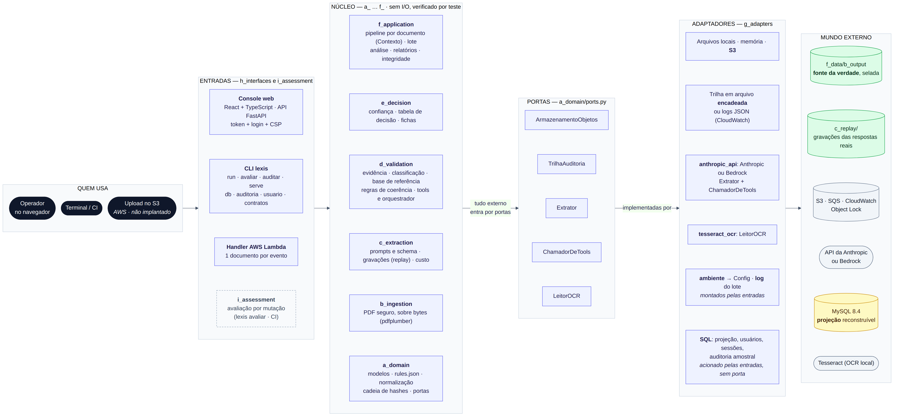

<p align="center">
  
</p>

# Lexis — extração auditável de avisos de eventos corporativos

Lê avisos de **proventos, grupamentos e bonificações** (PDF nativo ou escaneado) e entrega, para cada documento, um **registro estruturado, validado e auditável**: o que foi extraído e **de onde**, quão confiável é cada campo, o resultado da validação e **o que precisa de olhar humano (e por quê)**.

Feito para Asset Servicing, onde erro de extração é erro financeiro: classificar errado o tipo de provento muda o tratamento tributário, datas incoerentes quebram conciliações e valor inventado vira prejuízo.

> **A ideia em uma frase:** o modelo **só lê e cita** o texto do documento; o **código** verifica, valida, pontua e decide. Nada é aprovado no escuro.

## O que você ganha

- **Nenhum valor sem prova.** Cada campo traz o trecho literal e a página. Se o trecho não existe no documento, o campo vira `INCERTO` e vai para revisão.
- **Decisão explicável.** Cada documento termina em `APROVADO_AUTO`, `AGUARDA_EMISSOR`, `REVISAO_HUMANA` ou `FALHA_PROCESSAMENTO`, com a linha da tabela de decisão que decidiu e o que falta para aprovar.
- **Defesa em profundidade.** PDF hostil, injeção de prompt, texto oculto, saída malformada, scan ambíguo, adulteração da trilha: [catálogo de 100+ defesas](e_docs/f_governance/defenses.md).
- **Reprodutível e barato de avaliar.** As respostas reais do modelo estão gravadas: dá para rodar o lote **sem rede e sem chave de API**.
- **Console web** para o operador ver o documento com o trecho destacado e registrar a decisão de revisão.

## Arquitetura

[](e_docs/c_architecture/diagrams/architecture.png)

**Arquitetura hexagonal.** O núcleo não faz I/O: dados entram, registro sai. Armazenamento, trilha de auditoria, API do modelo, OCR e variáveis de ambiente entram por *portas*, com os *adaptadores* em `g_adapters/`. Por isso o mesmo código roda no terminal, no console web, em testes (memória + extrator falso) e numa Lambda. Um teste de arquitetura falha se o núcleo importar biblioteca de I/O ou adaptador. Detalhes: [architecture.md](e_docs/c_architecture/architecture.md).

## Pipeline

[](e_docs/c_architecture/diagrams/pipeline.png)

*Clique na imagem para ampliar.* Cada etapa, com o arquivo onde vive e o que acontece quando falha: [pipeline.md](e_docs/c_architecture/pipeline.md).

| Etapa | Em uma linha |
|---|---|
| ① Ingestão | Limites, SHA-256, texto visível × oculto, conteúdo ativo só sinalizado; nada é executado |
| ② Leitura pelo modelo | Só trechos literais, em schema estrito; scan tem duas leituras + OCR local |
| ③ Verificação | O trecho existe? Normaliza em `Decimal`/data ISO; classifica por sinais e compara com o modelo |
| ④ Validação | O modelo pede *tools* (base de referência, datas, tributação, proporção); o código confere e executa |
| ⑤ Decisão | Confiança por campo e tabela de decisão (a primeira linha verdadeira vence) |
| ⑥ Saída | JSON por documento, relatório de exceções e trilha com cadeia de hashes |

## Resultado sobre o lote (8 documentos)

| # | Documento | Decisão | Por quê |
|---|---|---|---|
| 01 | Energética Vale do Tietê (dividendo) | `APROVADO_AUTO` | IRRF condicional: **não** há líquido por ação, e o código não calcula nenhum |
| 02 | Banco Meridional (JCP) | `APROVADO_AUTO` | Líquido confere com bruto × (1 − 17,5%) |
| 03 | Siderúrgica Paranaense (JCP) | `REVISAO_HUMANA` | Título diz "Dividendos"; o corpo é JCP. Muda o tratamento tributário |
| 04 | Rede Varejo (JCP) | `AGUARDA_EMISSOR` | Pagamento "a definir": fica `PENDENTE`, nunca inventado |
| 05 | Aurora Saneamento (dividendo) | `REVISAO_HUMANA` | Pagamento (10/07) anterior à data com (15/07) |
| 06 | Petroquímica Litoral (grupamento 10:1) | `APROVADO_AUTO` | Sem valor nem pagamento: `NAO_APLICAVEL`, não "ausente" |
| 07 | Telecom Norte (JCP, **scan**) | `APROVADO_AUTO` | Duas leituras concordam **e** o OCR independente corrobora; confiança limitada a MÉDIA |
| 08 | Construtora Horizonte (bonificação) | `REVISAO_HUMANA` | Emissor, ISIN, ticker e CNPJ **fora da base de referência** |

> **Leia com cuidado.** São 8 documentos, um modelo não determinístico e regras, prompts e limiares ajustados sobre este mesmo lote: isto mede **esta amostra**, não a acurácia em produção. As respostas do modelo são **reais** (`claude-sonnet-5-5`, ≈ 49 mil tokens, ≈ US$ 0,21), gravadas em [`c_replay/`](c_replay). O código **não foi implantado na AWS** (só testado com clientes falsos). Detalhes e o que a execução real encontrou: [evaluation.md](e_docs/i_evaluation/evaluation.md).

## Como rodar

```bash
python3 -m venv .venv && source .venv/bin/activate
pip install --require-hashes -r requirements-dev.txt && pip install --no-deps -e .

lexis run          # lote em replay (sem rede, sem chave) -> f_data/b_output/report_yymmdd_hhmm
lexis avaliar      # injeta defeitos e mede se deixam de ser aprovados
lexis auditar f_data/b_output/report_yymmdd_hhmm   # a trilha e os registros ainda são os gravados?
pytest -q          # 343 testes, sem rede
```

**Console web** (executar o lote, ver o documento com o trecho destacado, registrar a decisão):

```bash
pip install --require-hashes -r requirements.txt && pip install --no-deps -e .
cd a_src/a_frontend && npm ci && npm run build && cd ../..
lexis serve        # imprime http://127.0.0.1:8000/#token=...  (abra esse endereço)
```

**Docker** (MySQL + console, sem instalar Python nem Node):

```bash
d_scripts/a_start.sh                                              # sobe tudo e imprime o endereço
# com banco o console exige login: crie a conta na própria tela, ou pela CLI:
docker compose run --rm cli usuario criar ana@empresa.com.br --nome "Ana Lima"
```

**Chamar o modelo de verdade** (opcional): `cp .env.example .env`, preencha `ANTHROPIC_API_KEY` e rode `lexis run --modo live --forcar`. Modos, variáveis, OCR, banco, auditoria amostral e Docker em detalhe: [operations.md](e_docs/h_operations/operations.md).

## Decisões que definem o projeto

Todas, com alternativas e o que muda em escala, em [decisions.md](e_docs/g_decisions/decisions.md). As principais:

- **Híbrido, não agente autônomo.** O fluxo é conhecido; autonomia só traria variabilidade e custo.
- **Texto literal + verificação de evidência** é o controle central contra "resposta plausível, mas errada".
- **`NAO_APLICAVEL` ≠ `AUSENTE` ≠ `PENDENTE`**, por tipo de evento (`rules.json`).
- **Alíquota vem do aviso**, nunca do código; líquido = bruto × (1 − alíquota).
- **Classificação com segunda opinião:** sinais por zona (campo > título > corpo) contra o modelo; divergência ⇒ revisão.
- **Function calling de verdade, com o código no controle:** allow-list, argumentos iguais ao extraído, veredito = resultado da tool.
- **Confiança em níveis discretos com motivos**, não nota numérica (não há base rotulada para calibrar).
- **Scan sem OCR independente sempre vai ao humano:** duas leituras do mesmo modelo são evidência fraca.
- **Arquivos selados são a fonte da verdade; o banco SQL é projeção reconstruível.**
- **Avaliação agnóstica ao documento:** mutação + auditoria amostral, sem gabarito manual.

## O que decidi não fazer (e por quê)

Lista completa (20 itens) em [decisions.md §7](e_docs/g_decisions/decisions.md#7-o-que-decidi-não-fazer-e-por-quê). Os principais:

| Não fiz | Motivo | Quando faria |
|---|---|---|
| Agente autônomo, multiagente, LangChain | Fluxo conhecido; autonomia reduz auditabilidade | Tarefas abertas |
| RAG / banco vetorial | Base de 12 linhas; match exato é mais auditável | Catálogo grande e textual |
| Banco como fonte única da verdade | Dois registros oficiais poderiam divergir | Banco com trilha imutável aceito pela auditoria |
| SSO, papéis e MFA | O login local atende a identidade na trilha; banco de investimento usa identidade corporativa | Qualquer uso fora da máquina local |
| Implantar na AWS / IaC | Sem conta aqui; código preparado e testado com clientes falsos | Antes de qualquer uso real |
| Escolher o modelo no console | Só o Sonnet tem evidência medida | Outro modelo medido em modo sombra |
| Validar dígito de ISIN/CNPJ | A base sintética falharia | Dados reais |
| Corrigir campos e revalidar no console | Reabriria normalização, regras e decisão | Com aprovação por quatro olhos |

## Segurança

O catálogo completo (ameaça → defesa → código → teste → limite) está em [defenses.md](e_docs/f_governance/defenses.md); o mapeamento a OWASP LLM Top 10 e NIST AI RMF, em [security_and_audit.md](e_docs/f_governance/security_and_audit.md).

| Ameaça | Defesa principal |
|---|---|
| Injeção de prompt no PDF | Conteúdo como **dado** entre `<doc_nonce>`; o modelo só cita; tudo validado no código; heurística só como alerta |
| Texto oculto, conteúdo ativo, PDF malicioso | Texto oculto excluído e sinalizado; nada é executado; limites de 20 MB / 20 páginas |
| "Plausível, mas errado" | Evidência literal, normalização no código, base de referência, regras de coerência, classificação por sinais |
| Agência excessiva do modelo | 4 tools somente leitura, allow-list, argumentos iguais ao extraído |
| Consumo ilimitado | `max_tokens`, timeout, orçamento de tokens, circuit breaker |
| Adulteração da trilha | Cadeia de hashes + `lexis auditar` (detecta; impedir exige Object Lock) |
| Console exposto | Só loopback, token por subida, `Host` conferido, CSP restritiva, login com scrypt |
| SQL injection | Toda consulta parametrizada |
| Cadeia de suprimentos | Lockfile com hashes, `pip-audit`, `npm audit`, `gitleaks` no CI |

**Egress de dados:** o conteúdo do documento é enviado à API do provedor. O lote é sintético; em produção exige DPA/zero-retention, região e classificação do dado.

## Testes e avaliação

- **343 testes Python** (inclui um teste de arquitetura que garante o núcleo sem I/O) + **95 do front** + **7 de ponta a ponta** (Playwright, com axe e checagem de CSP). `ruff`, `mypy --strict`, `pip-audit`, `tsc --strict` e `npm audit` limpos; o CI roda tudo.
- **Avaliação por mutação:** 53/53 defeitos injetados deixam de ser aprovados, incluindo citação truncada no meio do número. Limites conhecidos que ainda passam: valor plausível injetado no próprio documento e **data real de outro campo** (ex.: a data de aprovação citada como data com), porque a evidência confere que o trecho existe, não que pertence ao rótulo. É teste de regressão da lógica, **não** estimativa de acurácia em produção.
- **Auditoria amostral** dos `APROVADO_AUTO` (no banco), com intervalo de Wilson de 95%: é como o falso aprovado automático seria medido em operação. Ainda **não há vereditos reais** acumulados.
- **Não testado:** concorrência e carga, AWS real, leitor de tela de verdade (navegação por teclado é coberta pelo e2e).

## Escala (milhares de documentos)

Escala sem mudar o desenho: documentos independentes, cache e idempotência por SHA-256, prompt caching, S3 → SQS → Lambda (handler pronto, **não implantado**). **Falta:** vereditos acumulados para calibrar a confiança, priorização da fila humana (com 50% de abstenção, 5 mil avisos viram 2.500 revisões), SSO, idempotência concorrente e base de referência indexada. Tabela completa e ordem sugerida: [decisions.md §9](e_docs/g_decisions/decisions.md#9-em-escala-milhares-de-documentos).

## Estrutura

```
a_src/
  a_frontend/        console web (React + TypeScript + Vite)
  b_backend/lexis/   código Python em camadas a_ … i_ (ver arquitetura)
  c_database/        schema_mysql.sql (gerado) e consultas.sql (testadas)
b_tests/             a_unit · b_integration · c_security
c_replay/            gravações das respostas reais do modelo: <sha256>/<etapa>.json
d_scripts/           a_start.sh · b_stop.sh · c_destroy.sh (ciclo de vida do docker compose)
e_docs/              documentação (índice abaixo)
f_data/              a_input (PDFs) · b_output (report_yymmdd_hhmm/) · c_golden_records
.github/             CI, instruções do projeto, prompts e skills
Dockerfile · docker-compose.yml
```

## Documentação

Índice em [e_docs/README.md](e_docs/README.md).

| Quero… | Leia |
|---|---|
| Entender o caminho de um documento | [pipeline.md](e_docs/c_architecture/pipeline.md) |
| Entender como o código se organiza | [architecture.md](e_docs/c_architecture/architecture.md) |
| Saber **por que** cada escolha foi feita | [decisions.md](e_docs/g_decisions/decisions.md) |
| Ver **todas as defesas** | [defenses.md](e_docs/f_governance/defenses.md) |
| Rodar, configurar, usar Docker e banco | [operations.md](e_docs/h_operations/operations.md) |
| Ver o que foi medido e o que não foi | [evaluation.md](e_docs/i_evaluation/evaluation.md) |
| Levar para a AWS | [aws.md](e_docs/c_architecture/aws.md) |
| Estender (novo tipo de evento, nova regra) | skill [`lexis-extend-rules`](.github/skills/lexis-extend-rules/SKILL.md) |
| Regravar com o modelo real | skill [`lexis-live-recording`](.github/skills/lexis-live-recording/SKILL.md) |
| Mexer nas tools do modelo | skill [`lexis-function-calling`](.github/skills/lexis-function-calling/SKILL.md) |
