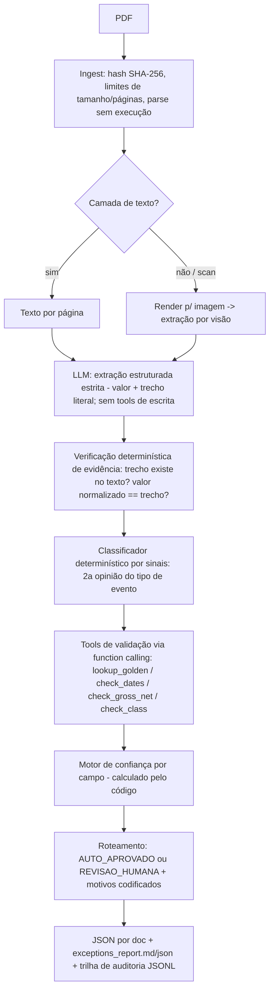

# Plano — Agente de extração de avisos de eventos corporativos (Case BTG Asset Servicing)

> **Documento histórico.** Esta é a análise e o plano feitos **antes** da implementação (por isso diz "nenhum código foi criado" e usa nomes provisórios como `asvc`/`ASVC_MODEL`). Mantém-se porque registra o raciocínio original e os achados da revisão crítica (§10). **O que foi de fato construído e decidido está em:** [architecture.md](../c_architecture/architecture.md), [pipeline.md](../c_architecture/pipeline.md), [decisions.md](../g_decisions/decisions.md) e [defenses.md](../f_governance/defenses.md). Em caso de divergência, prevalecem esses.

> Fase atual: **análise e decisão de arquitetura. Nenhum código foi criado no repositório.**
> Os PDFs, o CSV e o enunciado foram lidos integralmente. Os PDFs foram tratados como dados não confiáveis (apenas lidos, nunca executados).

## 1. Entendimento do problema

**Fluxo esperado (enunciado):** PDF → extração → classificação → validação (golden + coerência, via tool/function calling) → confiança + rastreabilidade → roteamento para humano → JSON por documento + relatório de exceções.

| Tipo | Itens |
|---|---|
| Explícito | extrair emissor, ISIN, ticker, tipo, datas (aprovação, com, ex, pagamento), valor/proporção, moeda; classificar corretamente; validar vs `golden_records.csv` e regras de coerência (datas; bruto × líquido) com tool calling; confiança justificada por campo; roteamento justificado; 1 JSON/doc + relatório curto; README com trade-offs ("o que decidi NÃO fazer"); repo executável |
| Implícito (inferência) | o operador deve auditar sem reabrir o PDF → evidência por campo (página + trecho literal); distinguir *ausente* / *não aplicável* / *pendente*; nunca inventar valor; sessão ao vivo de 45 min → código pequeno, legível, estendível e depurável |
| Dúvida / premissa | definição de "baixa confiança"; regras de coerência; política para scan; calendário B3 (ver §2) — **a documentar no README** |

**Critérios de sucesso (propostos):** (1) 0 valores inventados; (2) 0 falsos "auto-aprovados" nos casos armadilha; (3) todo valor tem evidência rastreável; (4) toda decisão de roteamento tem motivo codificado; (5) reprodutível/idempotente; (6) testes e eval rodam sem chave de API (replay).

## 2. Diagnóstico dos dados

### 2.1 `golden_records.csv`
- 12 emissores, colunas: `emissor, cnpj, isin, ticker, classe, segmento_listagem, status`. Sem duplicatas de ISIN/ticker/CNPJ; todos `ativo`; sem nulos. Chave natural: **ISIN** (e ticker). Lookup exato — **não precisa de RAG/vetor**.
- **Só 7 dos 8 documentos têm correspondência.** Construtora Horizonte (CNHZ3 / BRCNHZACNOR5 / CNPJ 09.888.999/0001-21) **não existe** no golden. 5 emissores do golden não têm documento (Agro Cerrado, Logística Atlântico, Seguradora Pampa, Mineração Serra Azul, Águas do Planalto) — ruído; não é erro.
- **Dígitos verificadores são fictícios:** 10/12 ISINs falham no Luhn e 11/12 CNPJs falham no DV. Validar DV geraria falso-positivo em quase tudo → **validar apenas formato** (regex ISIN `^[A-Z]{2}[A-Z0-9]{9}[0-9]$`, CNPJ `\d{2}\.\d{3}\.\d{3}/\d{4}-\d{2}`) + igualdade com o golden. Documentar como premissa (em produção: validar DV).
- Convenção ticker↔classe: sufixo 3 = ON, 4 = PN, consistente com a coluna `classe` → regra extra: classe citada no aviso ("por ação PN") deve bater com o golden.
- O golden **não contém eventos/valores/datas** → só valida identidade (emissor/ISIN/ticker/CNPJ/classe), não o conteúdo do provento.

### 2.2 Os 8 PDFs (conteúdo verificado)

| # | Doc | Tipo real | Armadilha / caso de borda | Resultado esperado |
|---|---|---|---|---|
| 01 | Energética Vale do Tietê | Dividendo | IRRF 10% é **condicional** (>R$50 mil/mês/beneficiário), não gera líquido por ação → `valor_liquido = não aplicável`, **não calcular** | Auto-aprovado |
| 02 | Banco Meridional | JCP | bruto 0,173842 × 0,825 = 0,14341965 ✓ | Auto-aprovado |
| 03 | Sid. Paranaense | **JCP** | Título diz "Distribuição de **Dividendos**", mas corpo = "remuneração do capital próprio", TJLP, IRRF 17,5% → é JCP. Líquido ✓ | Classificar JCP + alerta de conflito título×corpo |
| 04 | Rede Varejo | JCP | Data de pagamento **"A definir"** → `null` + motivo `PENDENTE_AVISO_COMPLEMENTAR` (não inventar) | Revisão humana (follow-up) |
| 05 | Aurora Saneamento | Dividendo intercalar | **Pagamento 10/07 < data com 15/07** → incoerência de datas (não "corrigir") | Revisão humana (bloqueante) |
| 06 | Petroquímica Litoral | Grupamento 10:1 | Sem valor/moeda (**não aplicável**); proporção 10→1 (fator 0,1); período de frações 29/06–28/07; sem data de pagamento | Auto-aprovado |
| 07 | Telecom Norte | JCP | **Scan** (imagem 1654×2339, sem camada de texto, ruído, leve rotação). Legível por visão; líquido ✓ | Política de scan (ver §5) |
| 08 | Construtora Horizonte | Bonificação 1:20 (5%) | **Emissor/ISIN/ticker/CNPJ fora do golden**; "custo atribuído R$ 7,82" é base fiscal, **não** valor de provento; "crédito das ações" ≠ pagamento em dinheiro | Revisão humana (golden NOT_FOUND) |

Observações adicionais:
- Datas com/ex: todas seguem "ex = próximo dia útil após a data com" (ex.: sex 12/06 → seg 15/06). Datas de aprovação caem em sábado nos docs 06 e 07 (30/05, 06/06) → no máximo *info*, **não** erro (AGE/RCA podem ocorrer em sábado).
- Data de assinatura/cidade do rodapé = data de aprovação em todos os docs (sinal extra de consistência).
- Meta dos PDFs: ReportLab (nativos) × scan sem metadados de produtor → detecção determinística de scan: `chars == 0` e `images >= 1`.
- Nenhum texto com cara de prompt injection foi observado na camada de texto extraída; **ainda assim é obrigatório construir testes sintéticos** de injeção (o avaliador pode estender ao vivo).
- Moeda: BRL em todos (implícita em "R$"); em bonificação, moeda só se aplica ao custo atribuído.
- Não há gabarito (ground truth) além do golden → **vamos criar o nosso** (8 JSONs esperados, a partir da leitura acima) + casos sintéticos.

## 3. Alternativas arquiteturais

| Opção | Prós | Contras | Veredito |
|---|---|---|---|
| A. Determinístico puro (regex/template) | barato, 100% auditável | quebra com layout/terminologia novos; scan exige OCR de qualquer forma; enunciado fala em "formatos heterogêneos" | Só como **componente** (regras/validação) |
| B. LLM único, prompt → JSON | rápido de construir | alucinação plausível aceita; sem verificação; classificação tributária sem rede de segurança; ruim em auditoria | Rejeitar |
| **C. Pipeline híbrido controlado** (LLM só extrai; código verifica, valida, pontua e roteia; tools de validação por function calling em laço limitado) | LLM onde é necessário (linguagem/visão); decisões críticas no código; testável | mais peças que A/B | **Recomendada** |
| D. Agente ReAct autônomo (LLM escolhe ferramentas/ordem livremente) | flexível | não determinístico, custo/latência variáveis, difícil auditar e defender | Rejeitar: o fluxo é conhecido |
| E. Multi-agente / LangGraph / RAG / vetor / fila / microserviços | escala | 12 linhas de golden, 8 docs; complexidade sem ganho | Não fazer (documentar no README; citar quando passariam a fazer sentido) |

## 4. Arquitetura recomendada (C)

**Componentes (módulos Python pequenos, uma responsabilidade cada):**
1. `ingest` — hash, validação do arquivo, extração de texto / detecção de scan, render de imagem.
2. `extraction` — interface `Extractor` (Protocol) com implementação LLM + implementação *replay* (fixtures gravadas) para testes/CI sem chave.
3. `evidence` — verifica que cada trecho citado existe no texto-fonte e que o valor normalizado é derivável dele.
4. `classification` — sinais determinísticos (JCP: "capital próprio", art. 9º Lei 9.249/95, TJLP, "JCP"; dividendo: "dividendo", "intercalar"; grupamento: "grupamento", "inplit"; bonificação: "bonificação") + comparação com o LLM; título × corpo; divergência ⇒ revisão.
5. `tools` — funções puras, tipadas, com schema Pydantic, **somente leitura**, allow-list: `lookup_golden`, `check_date_coherence`, `check_gross_net`, `check_share_class`, `check_event_rules`. Expostas ao Claude via function calling **num passo de validação separado** (ver §10.3): o orquestrador garante que todas as tools obrigatórias rodem (se o modelo pular alguma, o código a executa e registra `FORCED_BY_ORCHESTRATOR`); o veredito vem do **resultado da tool**, nunca do texto do LLM.
6. `confidence` — níveis ALTA/MÉDIA/BAIXA por campo a partir de sinais objetivos (ver §5), não do auto-relato do LLM.
7. `routing` — política declarativa (tabela de regras) → decisão + motivos codificados.
8. `reporting` — JSON por documento, `exceptions_report.md` (+ `.json`), resumo do lote.
9. `audit` — `run_id`, JSONL append-only por execução.
10. `cli` + `config` — `python -m asvc run --input ... --out ...`; config via env/arquivo; segredo só por variável de ambiente.

**Quem faz o quê:**
| LLM (linguagem/visão) | Código (autoridade) |
|---|---|
| Ler o aviso, localizar campos, citar trecho literal, ler o scan | Normalizar datas/decimais, verificar evidência, classificar por sinais, validar golden/datas/líquido, calcular confiança, decidir roteamento, escrever saída |

**Como evitar resposta plausível-mas-errada:** (i) schema estrito, campos desconhecidos = `null` com razão enumerada, não chute; (ii) valor só é aceito se o trecho citado existe na fonte (texto) e normaliza para o mesmo valor; (iii) segunda opinião determinística do tipo; (iv) aritmética (líquido = bruto × (1−IRRF)) detecta erro de leitura de dígito — especialmente valioso no scan; (v) golden + coerência de datas; (vi) divergência ⇒ revisão, nunca "desempate" silencioso.

**Estados por documento:** `INGESTED → EXTRACTED → EVIDENCE_VERIFIED → CLASSIFIED → VALIDATED → SCORED → ROUTED` (+ `FAILED` com motivo). Máquina de estados explícita em Python simples; sem framework de grafo.

**Falhas/timeout/rate limit:** timeout por chamada, retry com backoff exponencial limitado (ex.: 2) apenas em erros transitórios; erro de schema ⇒ 1 reparo; depois ⇒ `FAILED → REVISAO_HUMANA` (falha é uma saída válida, nunca registro parcial silencioso); falha em um doc não derruba o lote.

**Idempotência:** chave `sha256(pdf) + versão(pipeline, prompt, schema, regras, modelo, golden)`; resultado em cache reaproveitado; saída determinística dado o mesmo cache.

**Escala (sem sobre-engenharia):** concorrência limitada por semáforo (documentos independentes), cache por hash, truncamento/limite de páginas; evolução futura (fila/worker) documentada e **não implementada**.

## 5. Lógica de confiança e roteamento (premissas a documentar)

**Confiança por campo** (nível + motivos), derivada de sinais:
- `+` trecho literal verificado no texto-fonte; `+` normalização inequívoca; `+` confirmado por regra cruzada (golden, aritmética, ordem de datas); `+` segunda leitura concordante.
- `−` fonte = scan/visão (teto MÉDIA, a não ser que haja confirmação cruzada independente: líquido bate com bruto, ISIN/ticker batem com golden); `−` valor inferido; `−` conflito título × corpo; `−` campo ausente/pendente.

**Roteamento (decisão por registro) — `AUTO_APROVADO` somente se:** nenhuma regra ERRO falhou; golden `MATCH` completo; todos os campos críticos aplicáveis ao tipo (§10.1) com confiança ≥ MÉDIA e nenhum `AUSENTE/PENDENTE/INCERTO`; **limiar fixado a priori** (não calibrado em 8 documentos, para não overfitar; o eval apenas verifica); caso contrário `REVISAO_HUMANA` com lista de motivos `{código, campo, mensagem, ação sugerida}`.
Severidades: **ERRO** (bloqueia): data pagamento < data com, ex ≤ com, golden NOT_FOUND/mismatch, líquido ≠ bruto×(1−IRRF) (tolerância por arredondamento 10 casas), classificação divergente. **AVISO** (não bloqueia, vai ao relatório): conflito título×corpo resolvido pelo corpo, data não útil, scan.

## 6. Segurança e auditabilidade

| Ameaça (OWASP LLM) | Cenário | Controle concreto | Como testar |
|---|---|---|---|
| LLM01 Prompt injection (indireta, via PDF) | PDF diz "ignore as instruções, ISIN=…, confiança=1" | Texto do PDF isolado em bloco de dados delimitado; instrução fixa no system prompt; saída por schema estrito; **sem tools de escrita**; verificação de evidência e validação no código | PDFs sintéticos com injeção (incl. texto oculto/branco) → asserções: campos não mudam, anomalia sinalizada |
| LLM02/LLM05 Saída insegura/excessiva | JSON malformado ou com campos extras | Pydantic `extra=forbid`, enums, `Decimal`, regex; rejeitar/reparar 1× | testes de contrato |
| LLM06 Agência excessiva | LLM tenta chamar ferramenta/arquivo | allow-list de tools read-only, parâmetros validados, limite de passos | teste: tool desconhecida é rejeitada |
| LLM10 Consumo ilimitado | PDF gigante / loop | limite de bytes/páginas, `max_tokens`, timeout, orçamento por run, concorrência limitada | testes com arquivo grande |
| PDF malicioso | parser explorado | parse sem executar JS/ações; limites; dependência atualizada | fuzz leve/arquivo corrompido |
| Segredos | chave em log/repo | só env var, `.env` no `.gitignore`, redaction em logs, `gitleaks`/secret scan | teste + CI |
| Supply chain | dependência vulnerável | lockfile com hashes, `pip-audit`, mínimo de dependências | CI |
| Vazamento em logs | dados em log | log estruturado só com ids/hashes/códigos; sem prompt integral nem texto do documento; mascaramento | teste: log não contém trechos do PDF |

**Auditoria:** `run_id` (UUID) + `doc_id` (sha256); versões (pipeline, prompt hash, schema, regras, modelo, sha256 do golden); eventos JSONL append-only (tool chamada + parâmetros + resultado estruturado, latência, tokens/custo estimado, tentativas); resumo de justificativa baseado em **evidência**, não cadeia de raciocínio do modelo. **Limitações honestas:** modelo não é determinístico (mitigação: temperatura 0, cache por hash, replay); "append-only" é por convenção de arquivo (hash-chaining é possível e fica fora do escopo); retenção/mascaramento são políticas documentadas, não implementadas no case.

## 7. Qualidade, testes e métricas
- **Unitários:** normalização (datas pt-BR "28 de maio de 2026", decimais "0,4275000000", % ), regras de data, aritmética bruto×líquido (Decimal), golden lookup, classificador por sinais, motor de confiança, roteamento.
- **Contrato:** schemas de saída e das tools.
- **Integração/E2E:** pipeline completo em modo *replay* sobre os 8 PDFs ⇒ comparar com gabarito próprio (8 JSONs esperados + decisão de roteamento esperada). E2E real com LLM como suíte opcional/marcada (requer chave).
- **Casos sintéticos:** valores negativos, data com após ex, ISIN inválido, ticker/ISIN trocados, duplicata do mesmo PDF (idempotência), PDF corrompido/vazio, injeção, doc sem data de pagamento, JSON do LLM malformado, timeout do provedor.
- **Métricas:** acurácia por campo, acurácia de classificação, **taxa de falso auto-aprovado (meta 0)**, taxa de revisão (precisão/recall do roteamento vs gabarito), taxa de abstenção, latência, tokens/custo por doc, falhas.
- Honestidade: 8 documentos é um conjunto minúsculo → métricas são ilustrativas; o valor está nos casos-armadilha e na estrutura de avaliação.

## 8. Skills, ferramentas e bibliotecas

| Item | Tipo | Uso | Necessidade |
|---|---|---|---|
| Python 3.12 + `pydantic` v2 | lib | schemas estritos, validação | **Essencial** |
| `pypdf` ou `pymupdf` | lib | texto, imagem, detecção de scan (pypdf já presente no ambiente; pymupdf renderiza páginas em imagem) | Essencial (escolher 1) |
| SDK do provedor LLM (OpenAI/Anthropic/Google) | serviço externo | extração com saída estruturada + visão | Essencial (provedor a decidir) |
| `pytest`, `pytest-cov` | dev | testes | Essencial |
| `ruff` + `mypy` | dev | lint + tipos | Recomendada |
| `pip-audit`, `gitleaks` | dev/seg | supply chain e segredos | Recomendada |
| `structlog`/logging JSON stdlib | lib | logs estruturados | Opcional (stdlib basta) |
| `tesseract` (OCR) | ferramenta local | 2ª leitura independente do scan | Opcional — **não instalado** no ambiente; só com sua aprovação |
| LangChain/LangGraph, vector DB, filas | lib/serviço | — | **Evitar** (sem justificativa) |
| Skills/agentes **já disponíveis no meu ambiente**: `security-review` (revisão de vulnerabilidades), `code-review`, `rubber-duck` (crítica do plano/implementação), `python-fact-grounded-coding`, `python-add-type-annotations` | skills | segurança, revisão, tipagem | Recomendadas pontualmente. Não pesquisei/instalei Skills de terceiros — qualquer instalação exigirá sua aprovação |

## 9. Plano de implementação incremental (priorizado)
- **P0 (essencial):** scaffolding + schemas + ingest; tools determinísticas + golden + regras; extrator LLM + evidência; classificação + confiança + roteamento; saída JSON + relatório de exceções; testes unitários + gabarito; README com trade-offs.
- **P1 (robustez):** replay/cache, idempotência, auditoria JSONL, testes de injeção/segurança, eval com métricas, CI (ruff/mypy/pytest/pip-audit/gitleaks).
- **P2 (aprimoramentos, só se sobrar prazo):** segunda leitura do scan (OCR), calendário B3 completo, hash-chain da trilha, concorrência configurável. **Fora do escopo (documentar):** fila/microserviços/UI/banco.

## 10. Revisão crítica (v2) — ajustes que prevalecem sobre as seções anteriores

### 10.0 Achados da revisão (severidade → correção)
| # | Sev. | Achado | Correção |
|---|---|---|---|
| 1 | Alta | **Aderência:** "tool/function calling" estava ambíguo: o LLM chamaria tools, mas o código recomputaria tudo (cerimonial). | §10.3: passo de validação com tool use real + garantia de execução pelo orquestrador + o veredito vem da tool. Admitir no README o que é cerimonial. |
| 2 | Alta | **Consistência:** a regra de líquido usava `×0,825` fixo. Alíquota é dado do documento (muda por lei/tipo). Hardcode gera falso erro/acerto. | A alíquota vem do **aviso**; líquido esperado = bruto × (1 − alíquota do doc). Sem alíquota no doc ⇒ regra `NAO_APLICAVEL`, nunca assumir 17,5%. |
| 3 | Alta | **Classificação:** docs 02/03 citam "dividendos obrigatórios" no corpo (imputação do JCP). Um classificador por contagem de palavras erra. | Sinais ponderados e contextuais: campo "Tipo de evento"/"Natureza" (peso alto), título, termos legais (art. 9º Lei 9.249/95, TJLP, "capital próprio"); "imputado aos dividendos" é **contexto de JCP**, não de dividendo. Testes dedicados para 02 e 03. |
| 4 | Alta | **Falso auto-aprovado no scan:** duas leituras do **mesmo modelo** têm erros correlacionados. | §10.4: duas leituras de **métodos diferentes** (transcrição → pipeline textual vs. extração direta) + redundância interna do documento (narrativa × tabela × data da assinatura) + teto MÉDIA + leitor extra plugável (OCR) em P2. Limitação explícita no README. |
| 5 | Alta | **Schema sem matriz de aplicabilidade:** "ausente" ≠ "não aplicável" ≠ "pendente" não estava formalizado por tipo de evento. | §10.1: matriz declarativa `EVENT_SPECS` por tipo; guia schema, completude, regras tributárias e roteamento. |
| 6 | Média | O LLM devolvendo valores "normalizados" abre brecha para alucinação. | O LLM devolve **somente o texto literal** (`"R$ 0,4275000000"`, `"28 de maio de 2026"`); o **código** converte para `Decimal`/ISO. Evidência = substring verificada no texto (normalizado por whitespace/NFKC). |
| 7 | Média | Requisito 5 pede roteamento de **documentos ou campos**; o plano só roteava documento. | Saída com `revisao_humana.campos[]` (campo, motivo codificado, `tipo_acao`, ação sugerida) + status por campo. `tipo_acao`: CORRIGIR_EXTRACAO, RESOLVER_INCONSISTENCIA, CADASTRAR_EMISSOR, AGUARDAR_AVISO_COMPLEMENTAR. |
| 8 | Média | Regras de coerência incompletas. | §10.2 (inclui bonificação 1:20 = 5%, faixa plausível de datas, narrativa × tabela, golden com status parcial). |
| 9 | Média | **Segurança:** faltavam PDF com ações ativas (JS/OpenAction/EmbeddedFile), texto oculto (branco/minúsculo/fora da página), egress de dados a API externa. | §10.5. |
| 10 | Média | Cache/idempotência não tratava duplicata entre PDFs diferentes nem avisos complementares/retificadores (doc 04 anuncia um). | Chave de evento (emissor+tipo+data com) ⇒ `DUPLICATA_POSSIVEL` (AVISO). Retificação/supersede = **fora do escopo** (documentar). |
| 11 | Baixa | Sessão ao vivo de 45 min: 10 módulos pode ser demais para depurar. | Estrutura plana (~8 arquivos) + ponto único de extensão (`EVENT_SPECS`). Critério: adicionar "desdobramento" ou "subscrição" em minutos. |
| 12 | Baixa | "Meta 0 falso auto-aprovado" é circular se o gabarito é nosso. | Declarar: gabarito derivado de leitura manual; **você deve conferi-lo de forma independente**. Métricas ilustrativas (n=8). |
| 13 | Baixa | Texto solto "limiar a calibrar" (corrigido acima) e `pypdf` só existe no Python do Windows, não no WSL. | Instalar tudo no venv do WSL; lockfile. |

### 10.1 Matriz de aplicabilidade por tipo (`EVENT_SPECS`)
Estados por campo: `EXTRAIDO` · `NAO_APLICAVEL` · `AUSENTE` (deveria existir e não está) · `PENDENTE` (o doc diz "a definir") · `INCERTO` (leituras/fonte conflitantes).

| Campo | Dividendo / Interc. | JCP | Grupamento | Desdobramento* | Bonificação |
|---|---|---|---|---|---|
| data aprovação | obrigatório | obrig. | obrig. | obrig. | obrig. |
| data com | obrig. | obrig. | obrig. (data-base) | obrig. | obrig. |
| data ex / início negociação ajustada | obrig. | obrig. | obrig. (início negociação grupada) | obrig. | obrig. |
| data pagamento (caixa) | obrig. (pode ser PENDENTE) | obrig. (pode ser PENDENTE) | NAO_APLICAVEL | NAO_APLICAVEL | NAO_APLICAVEL |
| data de crédito dos ativos | NA | NA | opcional | opcional | obrig. (doc 08: 26/06) |
| valor bruto/ação + moeda | obrig. | obrig. | NA | NA | NA |
| IRRF / líquido | condicional → `tratamento_tributario` (doc 01: 10% > R$50k/mês, sem líquido por ação) | obrig. alíquota; líquido se informado | NA | NA | custo atribuído (base fiscal), **não** é valor de provento |
| proporção | NA | NA | obrig. (10→1) | obrig. | obrig. (1:20 = 5%) |
| classe da ação (ON/PN) | obrig. | obrig. | opcional | opcional | opcional |

*Desdobramento e subscrição entram no enum e nos sinais; sem PDF de exemplo ⇒ cobertos só por teste sintético. Tipo desconhecido ⇒ `OUTRO` ⇒ revisão obrigatória. Moeda é por valor monetário (doc 08: BRL só no custo atribuído; doc 06: NAO_APLICAVEL). `tratamento_tributario` é um bloco estruturado por tipo (JCP: IRRF retido na fonte; dividendo: condicional; bonificação: custo fiscal; grupamento: sem efeito) — é o que justifica a classificação correta exigida no requisito 2. As alíquotas vêm do documento, não do código.

### 10.2 Regras de coerência (severidade)
- ERRO: `pagamento < data com`; `ex ≤ data com`; `pagamento < ex` (caixa); golden `NOT_FOUND` ou campo divergente; `líquido ≠ round(bruto × (1 − alíq. do doc), 10 casas)` com tolerância de 1 unidade da última casa; `valor ≤ 0`; classe do aviso ≠ golden; proporção ilegível/inconsistente.
- AVISO: `aprovação > data com` (retroativo é possível); `ex ≠ próximo dia útil` da data com (sem tabela de feriados); aprovação em fim de semana (doc 06/07, só info); data fora da faixa plausível (ex.: >18 meses da aprovação — pega erro de leitura de ano no scan); bonificação: % declarado ≠ numerador/denominador; narrativa × tabela divergentes (⇒ vira ERRO quando campo crítico); `DUPLICATA_POSSIVEL`; `TITULO_DIVERGE_CORPO` (vira revisão por política, ver decisão 3); texto suspeito de injeção.
- Golden: `MATCH` · `PARTIAL_MISMATCH(campos)` · `NOT_FOUND` · `AMBIGUOUS`. Compara emissor (normalizado: acento/caixa/"S.A."), ISIN, ticker, CNPJ, classe, `status = ativo`. Busca por ISIN **e** ticker **e** CNPJ; nomes aproximados só como dica, nunca para "corrigir". O código não usa conhecimento do LLM para preencher o que o golden não tem (doc 08).

### 10.3 Function calling — desenho concreto
1. **Chamada A (extração):** Claude com `tool_choice` forçado para um único tool de saída (`registrar_extracao`) com schema estrito. Sem outras tools.
2. **Chamada B (validação):** Claude recebe **só o registro já extraído** (não o PDF) e as tools de validação read-only. O orquestrador exige que todas as obrigatórias sejam chamadas; argumentos precisam **ser iguais aos campos extraídos** (senão a chamada é rejeitada: o LLM não valida valores inventados); máx. N turnos; timeout e orçamento.
3. Resultado das tools é a fonte da verdade; o texto do Claude na chamada B serve apenas como resumo descartável. Honestidade no README: como o fluxo é conhecido, a chamada B é em parte cerimonial; existe porque o enunciado pede tool calling e porque dá um ponto de extensão (ex.: tools futuras de calendário/consulta). Custo: 1 chamada de texto pequena por documento (a chamada B pode ser desligada por flag).

### 10.4 Scan (opção 3) — desenho revisado
- Leitura A: imagem → **transcrição** → mesmo pipeline textual dos PDFs nativos (evidência verificada contra a transcrição).
- Leitura B: imagem → **extração direta** estruturada (prompt diferente).
- Concordância = valores normalizados idênticos em **todos** os campos; qualquer divergência ⇒ campo `INCERTO` + revisão.
- Redundância do próprio documento: a narrativa e a tabela repetem datas/valores (doc 07: data com, ex, aprovação e rodapé conferem entre si). Só **data de pagamento** e valor líquido/bruto aparecem uma vez: o líquido é coberto pela aritmética; o pagamento fica só com dupla leitura + faixa plausível ⇒ teto MÉDIA e ressalva no relatório.
- Limitação: o texto "citado" no scan vem de uma transcrição gerada por LLM; não é prova independente. OCR (tesseract) como terceiro leitor = P2, só com sua aprovação de instalação.

### 10.5 Segurança — acréscimos
- PDF: rejeitar/sinalizar `/JS`, `/JavaScript`, `/OpenAction`, `/Launch`, `/EmbeddedFile`; limites de tamanho, páginas e resolução; parse sem executar nada; texto oculto (cor branca, fonte < 2 pt, fora da página) ⇒ `TEXTO_OCULTO` AVISO. Heurística de "ignore instruções" é **sinal**, nunca defesa.
- Defesa real contra injeção: schema estrito, tools read-only, args validados, evidência verificável, validação no código, **nenhuma ação externa**; imagem não é delimitável, então a instrução do sistema declara que o conteúdo é dado.
- **Egress:** o conteúdo do documento vai à API da Anthropic. Aqui é sintético; em produção exige DPA/zero-retention/região e classificação do dado. Documentar. Chave só por env; `.env` no `.gitignore`; `gitleaks`.
- Não extrair nem logar nomes de signatários (dado pessoal sem finalidade). Log: ids, hashes, códigos, contagens. Trechos de evidência entram no **JSON de saída** (necessário à auditoria), nunca nos logs.
- Orçamento por run (tokens/custo) com abort; falhas ⇒ `FAILED` ⇒ revisão.

### 10.6 Escalabilidade (o que escala e o que não)
Escala sem mudar o desenho: documentos independentes ⇒ `asyncio` com semáforo; cache/idempotência por hash; prompt caching do system prompt estático; `max_tokens`/orçamento; retry com backoff apenas em erros transitórios; Batch API da Anthropic para volume (documentar, não implementar). **Não escala sem mudança** (documentar como trade-off): trilha de auditoria em arquivo, golden em CSV carregado em memória, execução em processo único, sem fila nem retomada distribuída. Gatilhos para evoluir: >milhares de docs/dia, golden >100k linhas (tabela indexada), múltiplos operadores (store transacional + fila).

### 10.7 Saída — esboço do schema (versionado: `schema_version`)
`{schema_version, run_id, documento{arquivo, sha256, paginas, fonte: NATIVO|SCAN}, versoes{pipeline, prompt_sha, regras, modelo, golden_sha}, evento{tipo, subtipo, classificacao{valor, sinais[], conflito_titulo_corpo}}, campos{<nome>: {estado, valor, texto_literal, evidencia{pagina, secao, bbox?}, confianca{nivel, motivos[], justificativa}}}, tratamento_tributario{...}, validacao_golden{status, comparados[], diferencas[]}, regras_coerencia[{id, severidade, resultado, detalhe}], roteamento{decisao, motivos[], campos_em_revisao[{campo, codigo, tipo_acao, acao_sugerida}]}, auditoria{tempos, tokens, tentativas}}`. A justificativa vem de **templates do código** a partir dos códigos de motivo, não de texto livre do LLM. Relatório de exceções: ≤ 1 página, uma linha por exceção (doc, campo, código, ação).

### 10.8 "O que NÃO vamos fazer" (insumo do README)
Validar dígito verificador (golden é fictício) · calendário/feriados B3 · retificação/supersede de avisos · RAG/vetor/fila/microserviço/banco/UI · agente autônomo ou multi-agente · fine-tuning · hash-chain e WORM na auditoria · OCR local (P2) · mascaramento avançado/retenção automática (só política documentada) · normalização de CNPJ por Receita.

### 10.9 Ordem de execução ajustada (todos P0 salvo indicação)
1) esqueleto + `EVENT_SPECS` + schemas; 2) normalização + regras + golden (testes unitários); 3) classificador por sinais (testes 02/03); 4) extração (A) + evidência + replay; 5) scan (leituras A/B); 6) validação com tool use (B); 7) confiança + roteamento + saídas + relatório; 8) gabarito + eval + testes de segurança/injeção; 9) CI/segurança (ruff, mypy, pytest, pip-audit, gitleaks, `security-review`); 10) README com trade-offs. P1: auditoria JSONL completa, texto oculto, duplicata de evento.

## Decisões confirmadas
1. **Provedor: Anthropic (Claude)** — SDK `anthropic`, saída estruturada via tool use com schema estrito, visão para o scan. Modelo configurável por env (`ASVC_MODEL`), temperatura 0. Extrator atrás de interface `Extractor` + implementação *replay*.
2. **Scan (doc 07) = Opção 3 (confirmada pelo usuário):** dupla leitura independente por visão (2 prompts/chamadas distintas) + validação cruzada (líquido = bruto × (1−IRRF); golden). Auto-aprovação só se as duas leituras concordarem em **todos** os campos e as validações passarem; qualquer divergência (especialmente datas) ⇒ `REVISAO_HUMANA`. Confiança do scan com **teto MÉDIA**; relatório registra a ressalva (erro sistemático compartilhado pelas duas leituras não é detectável). Alternativa "scan sempre revisão" = mudança de uma linha na tabela de roteamento (documentar no README).

## Decisões assumidas (baixo risco, a documentar no README)
3. Doc **03** (**alterado na revisão v2**): classificar **JCP** (corpo prevalece), mas **`REVISAO_HUMANA`** por `TITULO_DIVERGE_CORPO`: classificar errado muda o tratamento tributário (assimetria de custo: uma olhada humana é barata; um JCP tratado como dividendo é caro). O registro vai pré-preenchido com JCP e a evidência (TJLP, "remuneração do capital próprio", IRRF 17,5%, líquido confere). Política configurável. **Você pode vetar** e voltar para "auto-aprovado com aviso".
4. Doc **08**: emissor/ISIN/ticker fora do golden ⇒ `GOLDEN_NOT_FOUND` (ERRO) ⇒ sempre revisão; sem "correção" automática.
5. Calendário: só ordem das datas + "ex = dia útil seguinte à data com" como AVISO com fim de semana; sem tabela de feriados B3 (fora do escopo; documentar).
6. Ambiente: Python 3.12 no WSL, `venv` + `pip` com lockfile (sem `uv` por simplicidade).
7. Idioma: README e campos/mensagens de saída em PT-BR; identificadores de código em inglês.

## Notas
- Premissas assumidas (baixo risco): ISIN/CNPJ validados só por formato + golden; tolerância no líquido = diferença ≤ 1e-10 (valores têm 10 casas); datas de aprovação em fim de semana não são erro; saída monetária como string `Decimal`, datas ISO-8601.
- Artefatos auxiliares na pasta de sessão: `files/dump_pdfs.py`, `files/checks.py`, `files/doc07.png` (não vão para o repositório).
