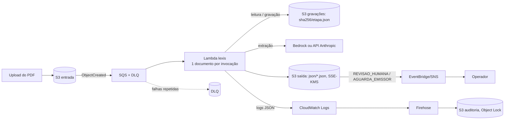

# lexis na AWS

Visão geral do sistema: [architecture.md](architecture.md) e [pipeline.md](pipeline.md).

> **Estado:** o código está **preparado** para a AWS (portas + adaptador S3 + handler Lambda), mas **nada foi implantado nem
> testado contra a AWS real**. Os testes (`b_tests/b_integration/test_aws.py`) usam um cliente S3 falso. O ID de modelo do
> Bedrock não foi verificado: defina `LEXIS_MODEL` conforme o catálogo do Bedrock da sua conta/região.

## Por que o núcleo já é portável

O núcleo (`a_domain` a `f_application`) recebe **bytes** e devolve um registro; armazenamento, trilha e provedor do modelo entram por portas
([`ports.py`](../../a_src/b_backend/lexis/a_domain/ports.py)). Trocar o ambiente é trocar o adaptador em `g_adapters/`:

| Porta / peça | Execução local (hoje) | AWS | Observações |
|---|---|---|---|
| `ArmazenamentoObjetos` (PDFs, saída, gravações, base) | `ArmazenamentoLocal` | **S3** (`ArmazenamentoS3`) | SSE-KMS, Block Public Access, versionamento, lifecycle |
| `TrilhaAuditoria` | `TrilhaArquivo` (JSONL) | **CloudWatch Logs** (`TrilhaLogsJson` no stdout) → **Firehose → S3 com Object Lock** para retenção imutável | o JSONL local é *append-only* só por convenção |
| `Extrator` (modelo) | API Anthropic (chave em env) | **Bedrock** (`anthropic.AnthropicBedrock`, autenticação por IAM, sem chave) ou API Anthropic com chave no **Secrets Manager** | `LEXIS_PROVEDOR=bedrock` |
| Base de referência (`Golden`) | CSV local | CSV no S3 hoje; **DynamoDB/Aurora** se passar de ~100 mil linhas | hoje `Golden` é classe concreta: ao migrar, extrair uma porta `BaseReferencia` |
| Execução em lote (CLI) | `lexis run` | **S3 Event → SQS (com DLQ) → Lambda** (1 documento por invocação) | `h_interfaces/aws_lambda.py` |
| Relatório de exceções | `publicar_relatorios` | Lambda agendada (EventBridge) ou **Athena** sobre `json/` | o handler grava 1 JSON por documento; o agregado é outro job |
| Fila de revisão humana | `relatorio_excecoes.md` e console web | evento **EventBridge/SNS** quando `decisao != APROVADO_AUTO` | não implementado na nuvem |
| Projeção SQL (`LEXIS_DB_URL`) | MySQL 8.4 no compose | **RDS/Aurora MySQL** (mesmo SQL; troca só a URL) | não implantado; o banco continua sendo projeção dos JSONs, não a fonte da verdade |

## Fluxo proposto



## Variáveis de ambiente do handler

| Variável | Função |
|---|---|
| `LEXIS_BUCKET_ENTRADA` | único bucket aceito como origem; eventos de **outros buckets são rejeitados** (confused deputy) |
| `LEXIS_BUCKET_SAIDA` | JSONs em `json/` |
| `LEXIS_BUCKET_GRAVACOES` | gravações de extração (padrão: o de saída, prefixo `gravacoes/`) |
| `LEXIS_BUCKET_REFERENCIA`, `LEXIS_CHAVE_GOLDEN` | base de referência (CSV) |
| `LEXIS_KMS_KEY_ID` | grava objetos com `aws:kms` (opcional) |
| `LEXIS_MODO` | `replay` \| `auto` (padrão) \| `live` |
| `LEXIS_PROVEDOR`, `LEXIS_AWS_REGION` | `anthropic` (padrão) ou `bedrock` |
| `LEXIS_SECRET_ARN` | segredo com a chave da API Anthropic (não usado no Bedrock) |
| `LEXIS_MODEL`, `LEXIS_TIMEOUT_S`, `LEXIS_MAX_RETRIES`, `LEXIS_TOKEN_BUDGET` | modelo, timeout, retries e orçamento de tokens |

## Comportamento sob falha e reentrega

- **At-least-once:** reentrega do mesmo evento não duplica: o registro é reaproveitado se o **SHA-256 do conteúdo** e as versões
  (código, regras, prompt, base, schema) forem iguais; **falhas nunca são reaproveitadas**.
- Falha de documento (PDF inválido, saída do modelo fora do contrato, provedor fora) vira registro `FALHA_PROCESSAMENTO`
  explícito. Falha de **infraestrutura** (S3 indisponível) é devolvida ao SQS como `batchItemFailures` (ou levantada, em evento
  S3 direto) para nova tentativa e, por fim, DLQ.
- Objetos acima de 20 MB são recusados **antes de ler o corpo** (o `ContentLength` da resposta é conferido antes de `Body.read()`).
- O circuit breaker e o orçamento de tokens valem **por invocação/lote**. Em Lambda de 1 documento, o controle real de gasto e de
  taxa é a **concorrência reservada** da função e o `maxConcurrency` do SQS, mais alarmes de custo.

## IAM de menor privilégio (exemplo)

```json
{
  "Version": "2012-10-17",
  "Statement": [
    {"Effect": "Allow", "Action": "s3:GetObject",
     "Resource": ["arn:aws:s3:::BUCKET_ENTRADA/*", "arn:aws:s3:::BUCKET_REFERENCIA/golden_records.csv"]},
    {"Effect": "Allow", "Action": ["s3:GetObject", "s3:PutObject"],
     "Resource": ["arn:aws:s3:::BUCKET_SAIDA/json/*", "arn:aws:s3:::BUCKET_SAIDA/gravacoes/*"]},
    {"Effect": "Allow", "Action": ["kms:Decrypt", "kms:GenerateDataKey"], "Resource": "ARN_DA_CHAVE_KMS"},
    {"Effect": "Allow", "Action": "bedrock:InvokeModel", "Resource": "ARN_DO_MODELO"},
    {"Effect": "Allow", "Action": "secretsmanager:GetSecretValue", "Resource": "ARN_DO_SEGREDO"}
  ]
}
```
Use *VPC endpoints* para S3, Bedrock e Secrets Manager (sem saída pública para a internet) e mantenha o *Block Public Access* ligado.

## Empacotamento e limites conhecidos

- Use **imagem de contêiner** para a Lambda: `pdfplumber`/`pillow` são pesados e o OCR opcional exige o binário `tesseract`.
- Lambda tem limite de 15 min por invocação. Documentos grandes ou muitos scans: mover para **Fargate**/Step Functions.
- Concorrência simultânea sobre o **mesmo** documento pode processá-lo duas vezes (resultado idêntico, custo duplicado). Para evitar:
  escrita condicional no **DynamoDB** (chave = sha256 + versões). **Não implementado.**
- Segurança do dado: o conteúdo do documento segue para o provedor do modelo. No Bedrock, o dado permanece na conta/região AWS
  conforme os termos do serviço (**confirmar com a equipe de compliance**); na API Anthropic, exige DPA/zero-retention.
- Sem IaC (Terraform/CDK) neste repositório: seria o próximo passo antes de qualquer implantação.

## Console web na AWS (proposta, não implantada)

Hoje o console roda só na máquina do usuário (`lexis serve`, loopback + token). Para um ambiente compartilhado, o desenho natural é:

- **Front** (`a_src/a_frontend`, build estático): S3 privado + **CloudFront** (OAC), com os mesmos cabeçalhos de segurança do servidor local
  (CSP `default-src 'none'; script-src 'self'; style-src 'self'; img-src 'self' data:; connect-src 'self'`) em uma *response headers policy*.
- **API** (`h_interfaces/api`, FastAPI): **Lambda** (via adaptador ASGI) ou **Fargate** atrás de API Gateway/ALB, no mesmo domínio do CloudFront (`/api/*`).
- **Autenticação:** trocar o token por subida por **Cognito** (JWT validado no gateway). O `ServicoExecucoes` hoje guarda manifestos em disco e
  roda um worker em *thread*: na nuvem, as execuções viram mensagens SQS para o handler Lambda já existente e o manifesto vai para **DynamoDB**
  (ou S3). **Não implementado**, e não é gratuito: exige trocar o armazenamento do serviço por um adaptador, como nas portas do núcleo.
- Páginas renderizadas (PNG) podem ser geradas sob demanda e cacheadas por `sha256+página` em S3.
