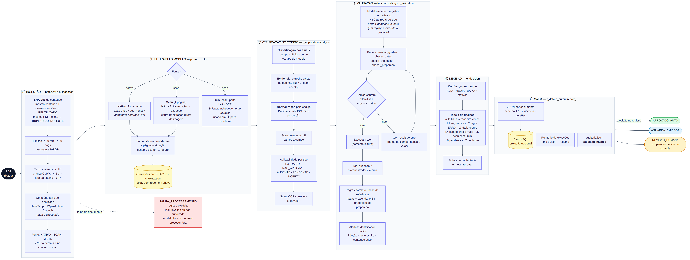

# Pipeline: o caminho de um documento

Do PDF ao registro auditável, etapa por etapa, com o arquivo onde cada passo vive. Visão de código e camadas: [architecture.md](architecture.md). Lista completa de defesas: [defenses.md](../f_governance/defenses.md).

*Clique para ampliar. Fonte editável: [diagrams/pipeline.mmd](diagrams/pipeline.mmd).*

## Princípio

> O modelo **lê e cita**. O código **verifica, valida, pontua e decide**.

O modelo nunca devolve valor normalizado, confiança nem decisão (campo extra no JSON é rejeitado). Um valor só vira `EXTRAIDO` se o trecho citado existir no texto-fonte **e** o código conseguir normalizá-lo sem ambiguidade.

## Etapas

### ① Ingestão (`b_ingestion/pdf.py`)

Roda **antes de qualquer chamada externa**; nada do PDF é executado.

| Passo | O que faz | Se falhar / disparar |
|---|---|---|
| Limites e assinatura | ≤ 20 MB, ≤ 20 páginas, começa com `%PDF-` | `ARQUIVO_GRANDE_DEMAIS`, `PAGINAS_DEMAIS`, `NAO_E_PDF` → `FALHA_PROCESSAMENTO` |
| SHA-256 | Identidade por **conteúdo** (cache, idempotência, gravações) | — |
| Texto visível × oculto | Exclui do texto enviado ao modelo: branco (cinza/RGB/CMYK), fonte < 2 pt, fora da página. Modo `3 Tr` (invisível) só é sinalizado: não dá para separar | aviso `TEXTO_OCULTO` → revisão (L1) |
| Conteúdo ativo | Procura `/JavaScript`, `/JS`, `/OpenAction`, `/Launch`, `/EmbeddedFile`, `/RichMedia`; **só sinaliza** | aviso `CONTEUDO_ATIVO_PDF` → revisão (L1) |
| Nativo ou scan | Scan = página com < 30 caracteres de texto e ao menos uma imagem | Misto ou várias páginas escaneadas → `DOCUMENTO_NAO_SUPORTADO` |
| Corrompido / vazio | `PDF_ILEGIVEL`, `PDF_VAZIO`, `SEM_CONTEUDO` | `FALHA_PROCESSAMENTO` explícita |

Antes de tudo isso, `batch.py` consulta a **idempotência**: mesmo SHA-256 **e** mesmas versões (pipeline, regras, prompt, base, schema) → `REUTILIZADO`, sem reprocessar. Mesmo PDF com outro nome no lote → `DUPLICADO_NO_LOTE`. Falhas nunca são reaproveitadas.

### ② Leitura pelo modelo (porta `Extrator`: adaptador `g_adapters/anthropic_api.py`; prompts e gravações em `c_extraction/`)

| Caso | Chamadas | Entrega |
|---|---|---|
| **PDF nativo** | 1 (`extracao`): texto por página dentro de `<doc_nonce>` | Extração estruturada |
| **Scan** (1 página) | 3: `transcricao` → `extracao_transcricao` (leitura A, mesmo caminho textual) e `extracao_direta` (leitura B, direto da imagem); mais **OCR local** (Tesseract, porta `LeitorOCR`, adaptador `g_adapters/tesseract_ocr.py`) como terceiro leitor, sem modelo | Duas extrações independentes + texto do OCR |

A saída é uma *tool call* `registrar_extracao`: para cada campo, **trecho literal** + página + situação (`PRESENTE`/`AUSENTE`/`A_DEFINIR`). Validada por pydantic (`extra=forbid`, enums, 400 caracteres por trecho, `PRESENTE` exige texto); fora do contrato → **1 reparo**; depois `SAIDA_FORA_DO_CONTRATO`.

Cada resposta é **gravada** em `c_replay/<sha256>/<etapa>.json` (`recordings.py`). Os modos:

| Modo | Comportamento |
|---|---|
| `replay` (padrão) | Só gravações; falta = `FIXTURE_AUSENTE`; gravação feita com outro prompt = `GRAVACAO_PROMPT_DIVERGENTE`. Sem rede, sem chave |
| `auto` | Gravação se existir, senão chama a API e grava. Documento 100% gravado **não cria cliente** |
| `live` | Sempre chama a API e regrava |

### ③ Verificação no código (`f_application/analysis.py`)

Núcleo **puro**: dados entram, registro sai.

1. **Classificação por sinais** (`classification.py`): título, campo de tipo e corpo, ponderados campo 3 : título 2 : corpo 1, neutralizando "imputado ao dividendo obrigatório" (destino contábil do JCP). Diverge do modelo → `CLASSIFICACAO_DIVERGENTE` (ERRO). Título ≠ corpo → `TITULO_DIVERGE_CORPO` (revisão por política).
2. **Evidência** (`evidence.py`): o trecho existe na página, sem cortar um número ao meio? Comparação em forma canônica (NFKC, sem acento, minúsculas, espaços colapsados). Não existe → campo `INCERTO` + `EVIDENCIA_NAO_ENCONTRADA`.
3. **Normalização** (`normalization.py`): `Decimal`, data ISO, percentual, proporção ("1 (uma) ação nova para cada 20"), classe. Ambíguo (duas datas, dois números) → `INCERTO` + `VALOR_NAO_INTERPRETAVEL`. O bbox do trecho é localizado para o destaque na tela (só em PDF nativo).
4. **Scan, leitura A × B**: as duas leituras precisam concordar **campo a campo** (`SCAN_LEITURAS_DIVERGEM`).
5. **Aplicabilidade** (matriz em `rules.json`): campo `NAO_APLICAVEL` (grupamento não tem pagamento), `AUSENTE` (obrigatório e não achado), `PENDENTE` (o aviso diz "a definir"): nunca confundidos.
6. **Scan, OCR**: o OCR precisa **corroborar** cada valor verificável por texto (`OCR_NAO_CORROBORA`); sem OCR → `OCR_INDISPONIVEL`.

### ④ Validação por function calling (`d_validation/tools.py`; conversa com o modelo pela porta `ChamadorDeTools`)

O núcleo não chama a API: quem conversa com o modelo é o adaptador `ChamadorAnthropic` (`g_adapters/anthropic_api.py`), injetado no `Contexto`. O modelo recebe o **registro já normalizado** (não o PDF) dentro de `<registro_nonce>` e **só as tools aplicáveis ao tipo**:

| Tool | Quando | Regras que executa |
|---|---|---|
| `consultar_golden` | sempre | Base de referência por ISIN/ticker/CNPJ (match **exato**); compara emissor e classe; status ativo |
| `checar_datas` | sempre | `ex > com`, `pagamento ≥ com/ex`, `crédito ≥ com`, ex = próximo dia útil (calendário B3), fim de semana, faixa de 550 dias |
| `checar_tributacao` | dividendo, JCP ou valores presentes | Valor > 0, **líquido = bruto × (1 − alíquota do aviso)** (tolerância 0,5 ulp), dividendo sem retenção por ação |
| `checar_proporcao` | grupamento, desdobramento, bonificação ou proporção presente | Termos > 0, sentido (grupamento reduz, desdobramento aumenta), percentual declarado × razão |

Cada pedido passa por `atender`: **allow-list** + **argumentos idênticos aos campos extraídos**. Divergiu → `tool_result` de erro apontando o **nome** do campo (nunca o valor certo) e o modelo tenta de novo (máx. 4 turnos). Tool obrigatória que o modelo não pediu é executada pelo orquestrador (origem `ORQUESTRADOR`). **O veredito é sempre o resultado da tool**; o parecer final do modelo é só informativo. A conversa inteira é gravada (`validacao_tools`) e, no replay, **cada pedido é reexecutado** pelo código e comparado.

Depois das tools, ainda em `analysis.py`: **formatos** (ISIN, ticker, CNPJ), **identificadores omitidos** (ISIN/ticker/CNPJ presentes no texto e ausentes da extração → `IDENTIFICADOR_NAO_EXTRAIDO`) e **sinais de segurança** (heurística de injeção `INJECAO_SUSPEITA`, texto oculto, conteúdo ativo). Os sinais são **alertas**, nunca a defesa.

### ⑤ Decisão (`e_decision/`)

**Confiança por campo** (`confidence.py`): `ALTA`/`MEDIA`/`BAIXA`, sempre com motivos. Extraído com evidência = ALTA; base de referência não encontrada rebaixa os campos de identidade a MÉDIA (não prova que a leitura esteja errada), mas a regra continua ERRO e bloqueia; scan limitado a MÉDIA; regra ERRO reprovada → BAIXA; alerta → no máximo MÉDIA; obrigatório ausente → BAIXA.

**Tabela de decisão** (`decision_table.TABELA`): a **primeira linha verdadeira** vence. Cada linha tem um teste.

| Linha | Condição | Decisão |
|---|---|---|
| L1 | Sinal de segurança (injeção, texto oculto, conteúdo ativo) | `REVISAO_HUMANA` |
| L2 | Alguma regra de severidade ERRO falhou (golden, datas, valores, evidência, classificação…) | `REVISAO_HUMANA` |
| L3 | Título diverge do corpo (política: risco tributário) | `REVISAO_HUMANA` |
| L4 | Campo crítico ausente, incerto ou abaixo de MÉDIA | `REVISAO_HUMANA` |
| L5 | Scan sem leitor independente do modelo | `REVISAO_HUMANA` |
| L6 | Informação obrigatória pendente no aviso | `AGUARDA_EMISSOR` |
| L7 | Nenhuma das anteriores | `APROVADO_AUTO` |

`fichas_conferencia` dizem *o que conferir e onde* (ação: `CORRIGIR_EXTRACAO`, `RESOLVER_INCONSISTENCIA`, `CADASTRAR_EMISSOR`, `AGUARDAR_AVISO_COMPLEMENTAR`, `CONFERIR_CLASSIFICACAO`, `VERIFICAR_SEGURANCA`, `REPROCESSAR`). `para_aprovar` simula a tabela com cada bloqueio resolvido sozinho e com todos juntos: determinístico, sem o modelo.

### ⑥ Saída e trilha (`f_application/batch.py`, `report.py`)

Em `f_data/b_output/report_yymmdd_hhmm/`:

| Arquivo | Conteúdo |
|---|---|
| `json/<doc>.json` | Registro completo (schema 1.1): campos, evidência, regras, decisão, fichas, versões, auditoria |
| `relatorio_excecoes.md` / `.json` | Documentos que exigem atuação (uma linha cada, com "para aprovar") e aprovados com ressalvas que não bloqueiam (avisos, scan) |
| `resumo_execucao.json` | Contagem por decisão, tokens, custo estimado, tempos |
| `auditoria.jsonl` | Eventos do lote, **cadeia de hashes**; termina com `registros_publicados` (SHA-256 de cada JSON) |
| `revisoes.jsonl` | Decisões do operador (só no console), também encadeado |

`lexis avaliar` grava o `avaliacao_mutacao.json` numa pasta `report_…` própria, não na de uma execução.

`lexis auditar <pasta>` confere a cadeia, cada registro contra o selo e cada decisão humana contra o registro revisado. Com `LEXIS_DB_URL`, a execução também é **projetada** no banco.

## Quando algo dá errado

| Situação | O que acontece |
|---|---|
| PDF inválido, grande, ilegível, não suportado | Registro `FALHA_PROCESSAMENTO` com código; o lote segue |
| Modelo fora do contrato | 1 reparo; depois `SAIDA_FORA_DO_CONTRATO` |
| Resposta truncada (`max_tokens`) | Nunca executa tool de resposta cortada |
| Recusa do modelo | `RECUSA_DO_MODELO` (com *fallback* do servidor, se ligado; resposta do fallback → `MODELO_NAO_AVALIADO`, revisão) |
| Credencial recusada / orçamento estourado | **Circuito abre**: lote para de chamar o provedor; o que já estava pronto continua valendo; nada bom é sobrescrito |
| 3 falhas seguidas do provedor | Circuito abre (`CIRCUITO_ABERTO` nos restantes) |
| Erro transitório numa Lambda (fila) | Devolvido à fila → DLQ; **não** vira resultado final |
| Exceção inesperada | `ERRO_INESPERADO` com *onde* (arquivo:linha), nunca a mensagem |
| Falha na validação por tools | A validação segue sem o modelo: o orquestrador executa as tools |

## Anatomia do registro (`schema_version 1.1`)

Contrato completo: [output_record.schema.json](../e_contracts/output_record.schema.json).

| Seção | Conteúdo |
|---|---|
| `documento` | arquivo, SHA-256, páginas, fonte (`NATIVO`/`SCAN`), avisos de ingestão |
| `versoes` | pipeline, regras + hash, prompt, modelo, extrator, base de referência, schema |
| `decisao` | `estado` (`APROVADO_AUTO` \| `AGUARDA_EMISSOR` \| `REVISAO_HUMANA` \| `FALHA_PROCESSAMENTO`), `resumo`, `motivos` codificados, `linha_da_tabela` que decidiu e, quando não aprovou, `para_aprovar` |
| `evento` | tipo final, rótulo, classificação (tipo do modelo, pontuação, sinais, conflito título × corpo) e `tratamento_tributario` descritivo (não é parecer) |
| `campos.<nome>` | `estado`, `valor` normalizado, `texto_literal`, `evidencia` (página, trecho, bbox, fonte) e `confianca` (nível + motivos + justificativa) |
| `validacao_golden` | `MATCH` \| `PARTIAL_MISMATCH` \| `NOT_FOUND` \| `AMBIGUOUS`, campo a campo; sugestão por nome só como dica |
| `regras` | cada regra avaliada: `OK`/`FALHA`/`NAO_APLICAVEL`, severidade, esperado × observado |
| `fichas_conferencia` | por exceção: o que conferir, onde (página/trecho) e a ação |
| `auditoria` | chamadas ao modelo (etapa, modelo que de fato respondeu, tokens, latência, origem `API`/`CACHE`), chamadas de tools (origem `MODELO`/`ORQUESTRADOR`, aceita/rejeitada com motivo), `validacao_pelo_modelo` (parecer informativo), tokens e custo estimado |

A justificativa é montada a partir de **códigos de motivo** e evidências, não do raciocínio do modelo.

## Estados de um campo

| Estado | Significa |
|---|---|
| `EXTRAIDO` | Trecho verificado e normalizado |
| `NAO_APLICAVEL` | Não existe para este tipo de evento (ex.: pagamento em grupamento) |
| `AUSENTE` | Deveria existir e o aviso não traz |
| `PENDENTE` | O próprio aviso diz que será informado depois |
| `INCERTO` | Citação inexistente, valor ambíguo ou leituras divergentes |
